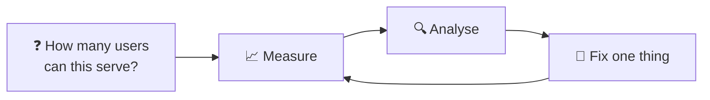
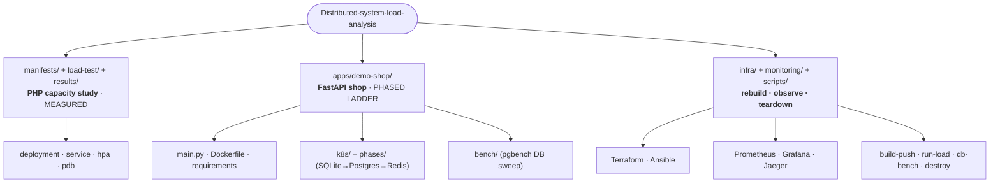
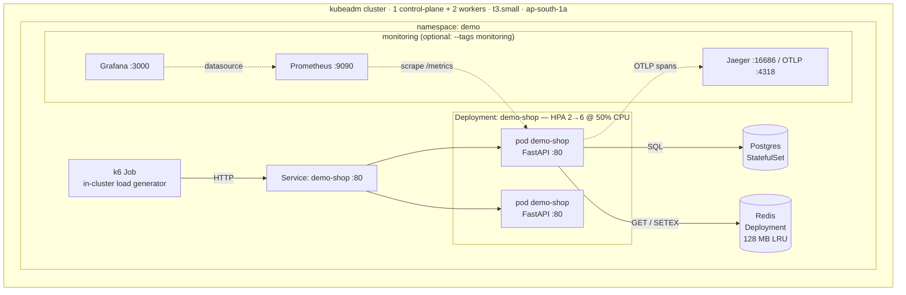
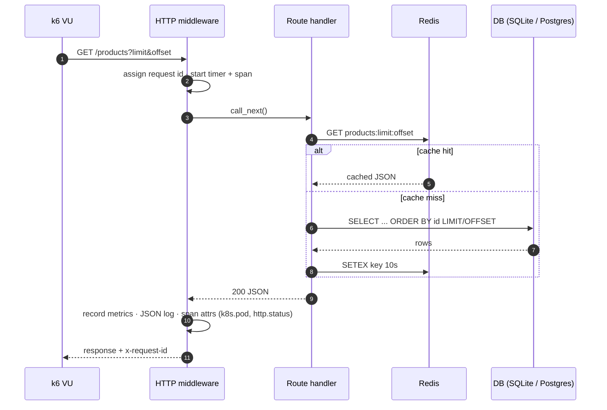
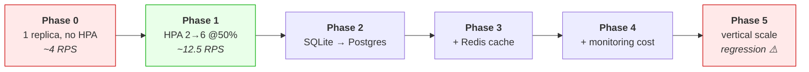
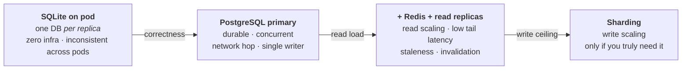
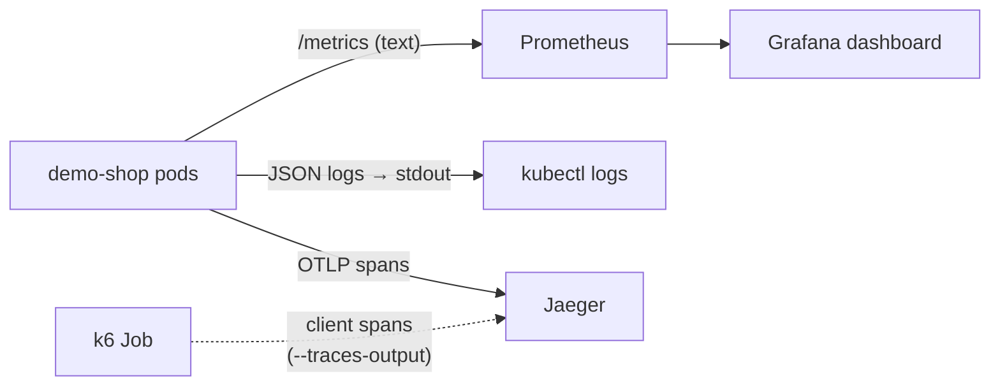
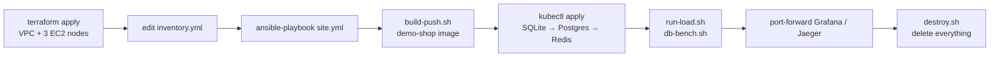

# Distributed System Load Analysis

A **capacity engineering lab**: take one small Kubernetes cluster, apply a
**real** web service to it, and find out *where* it breaks and *why* — one
single-variable change at a time, with a number and a trace to back up every
claim.

Everything is reproducible: the infra is rebuilt with Terraform + Ansible, the
load is generated **from inside the cluster** (so results measure the service,
not your laptop's Wi‑Fi), and one script tears the whole thing down so nothing
keeps billing.



---

## TL;DR

> These headline numbers are from the **original PHP CPU-burner study**
> (`results/results.md`). The FastAPI app in `apps/demo-shop/` is the platform
> for the *phased* ladder in `RESULTS_PHASES.md`.

| Setup | Reliable throughput | Concurrent users* | p95 | Errors |
|---|---|---|---|---|
| Single replica, no scaling | ~4 RPS | < 10 | 5–15 s | 26–33 % |
| HPA 1→6 @ 50 % CPU (final) | **~12.5 RPS (~1 M req/day)** | **~70–100** | ~2.3 s | < 1 % |
| Past the ceiling (80–150 VU) | **collapses** to 9–14 RPS | — | 13–19 s | 1–11 % |
| Naive vertical scale (1000m × 8) | **regressed** to 8.7 RPS | — | 6.6 s | 4.4 % |

\* Real users with ~5–10 s think time: `users ≈ RPS × (response + think)`.

**Three lessons worth the whole exercise:**

1. One unoptimized pod pins at its CPU limit — **more concurrency only queues**.
2. Horizontal scaling works *until the node runs out of CPU*, then the system
   **collapses instead of degrading gracefully**.
3. Raising pod limits before node capacity **makes things worse** — the failure
   is the finding.

---

## Two workloads live here

This repo deliberately contains **two** apps so the measured study and the
extensible lab don't get confused with each other.

| | `manifests/` | `apps/demo-shop/` |
|---|---|---|
| What | `registry.k8s.io/hpa-example` (php-apache) | **real** FastAPI shop |
| Purpose | the original capacity study | phased DB → cache → observability ladder |
| Behaviour | burns CPU per request | products, cart, checkout; SQLite/Postgres + optional Redis |
| Status | **measured** (numbers above) | framework in place — fill from your run |



---

## Architecture

A minimal single-AZ kubeadm cluster. Every workload lives in the `demo`
namespace; monitoring is optional so it can be tagged in/out.



Whole-node picture: [CLUSTER.md](CLUSTER.md) · Terraform: `infra/terraform/`.

---

## What happens on one request

Every request gets a **request id**, a latency histogram sample, a JSON log
line, and (when tracing is on) a server span with `k8s.pod`. `/products` is the
hot read path and the first thing the cache phase targets.



App code: [`apps/demo-shop/main.py`](apps/demo-shop/main.py).

---

## The capacity ladder

Each phase changes **exactly one thing**; hardware, HPA config, k6 script and VU
levels stay fixed so deltas are attributable.



| Phase | Change | Problem it fixes | Tradeoff |
|---|---|---|---|
| 0 · baseline | 1 replica, no HPA | — (the floor) | one pod = one CPU budget |
| 1 · scale out | HPA 2→6, 500m limits | single-pod CPU ceiling | node CPU becomes the limit |
| 2 · external DB | SQLite → PostgreSQL | per-pod DB inconsistency, single writer | network hop, shared node CPU |
| 3 · cache | Redis in front of `/products` | DB read hotspot | staleness ≤ TTL, warm-up cost |
| 4 · observe cost | Prometheus + Grafana + Jaeger | proves monitoring isn't free | steals CPU from a small node |
| 5 · counter-example | limits 1000m, 8 replicas | *(intentionally fails)* | node contention + T3 credits |

Run any phase with one command — see [PHASE_COMMANDS.md](apps/demo-shop/PHASE_COMMANDS.md),
full write-up in [RESULTS_PHASES.md](RESULTS_PHASES.md) and the narrative in
[SHOWCASE.md](SHOWCASE.md).

### Data tier evolution



Reasoning and cost/benefit per step: [DB_EVOLUTION.md](apps/demo-shop/DB_EVOLUTION.md).

---

## Observability & tracing

Three signals, all optional at runtime so headline throughput numbers never
depend on a collector being up.



| Signal | Endpoint / source | Enabled by |
|---|---|---|
| Health / readiness | `GET /health` (reports active db + cache) | always |
| Request metrics | `GET /metrics` | always |
| Request logs | stdout JSON (`rid`, `path`, `status`, `latency_ms`, `pod`) | always |
| DB query timing | `shop_db_query_seconds` histogram | always |
| Cache hit ratio | `shop_cache_events_total{result}` | `REDIS_URL` set |
| Distributed traces | OTLP → Jaeger | `OTEL_EXPORTER_OTLP_ENDPOINT` set |
| App scrape | Prometheus job for pods `app=demo-shop` | monitoring playbook |

UIs (port-forward): Prometheus `:9090`, Grafana `:3000` (`admin/admin`),
Jaeger `:16686`, app `:8080`.

> **Tracing caveat:** k6's built-in `--traces-output` emits k6's *own* spans but
> does **not** propagate `traceparent` to the request, so the k6 span and the
> app span are two separate traces by default. The app-side waterfall
> (route → `db.*` → `work.*`) is complete either way — which is what the phase
> analysis uses. Details: [TRACING.md](apps/demo-shop/TRACING.md).

Deep dives: [OBSERVABILITY.md](apps/demo-shop/OBSERVABILITY.md) ·
[TRACING.md](apps/demo-shop/TRACING.md).

---

## Quick start

### Lifecycle at a glance



### 0 · Prerequisites
Terraform, Ansible, `kubectl`, Docker, Python 3 (for the tracing patch), AWS creds.

### 1 · Rebuild the lab
```bash
cd infra/terraform && terraform init && terraform apply   # prints node IPs
cd ../ansible && cp inventory.example.yml inventory.yml    # set the 3 IPs
ansible-playbook -i inventory.yml site.yml                 # kubeadm + Calico + metrics
# optional: add monitoring
ansible-playbook -i inventory.yml site.yml --tags monitoring
```
Full guide: [infra/REBUILD.md](infra/REBUILD.md).

### 2 · Build & deploy the app
```bash
DOCKERHUB_USERNAME=<user> DOCKERHUB_TOKEN=<pat> ./scripts/build-push.sh

# Phase 1 — SQLite in-pod (also creates the `demo` namespace)
kubectl apply -f apps/demo-shop/k8s/deployment.yaml
# Phase 2/3 — Postgres, then + Redis
kubectl apply -f apps/demo-shop/phases/phase2-postgres.yaml
kubectl apply -f apps/demo-shop/phases/phase3-cache.yaml
```
Verify: `kubectl -n demo port-forward svc/demo-shop 8080:80` → open
`http://localhost:8080` (UI) or `curl localhost:8080/health`.

### 3 · Generate load
```bash
./scripts/run-load.sh                 # app-level capacity, prints a summary
TRACE=true ./scripts/run-load.sh      # + client→app→DB traces into Jaeger
./scripts/db-bench.sh                 # DB-only sweep (rows × clients) via pgbench
```
`run-load.sh` runs k6 **as an in-cluster Job** so the runner is never the
bottleneck. Watch scaling live: `kubectl -n demo get hpa demo-shop --watch`.

### 4 · Observe
```bash
kubectl -n demo port-forward svc/grafana 3000:3000     # dashboard (admin/admin)
kubectl -n demo port-forward svc/jaeger  16686:16686   # traces
kubectl -n demo port-forward svc/prometheus 9090:9090  # raw PromQL
```

### 5 · Destroy everything (no leftover charges)
```bash
./scripts/destroy.sh   # namespaces + cluster-scoped RBAC + terraform destroy + local artefacts
```

---

## Results

<details>
<summary><b>PHP capacity study — measured numbers (click to expand)</b></summary>

**A. Unoptimized — HPA pinned to 1 replica**

| VUs | RPS | p50 | p95 | max | Errors |
|---|---|---|---|---|---|
| 20 | 3.72 | 2.98 s | 5.50 s | 6.8 s | 25.97 % |
| 50 | 3.95 | 6.57 s | 15.14 s | 18.07 s | 32.81 % |

**B. Scalable — HPA 1→6**

| VUs | RPS | p50 | p95 | max | Errors |
|---|---|---|---|---|---|
| 30 | **12.52** | 1.14 s | 2.31 s | 4.64 s | **0.39 %** |
| 80 | 8.82 | 5.34 s | 18.88 s | 21.56 s | 0.74 % |
| 150 | 14.20 | 5.05 s | 12.69 s | 48.50 s | 11.25 % |

**C. Tuning experiment (reverted) — 1000m limits, 8 replicas**

| VUs | RPS | p95 | Errors |
|---|---|---|---|
| 30 | 8.72 | 6.64 s | 4.43 % |

8000m burst demand vs ~3600m allocatable on 2× t3.small → CPU contention +
T3 credit burn. Reverted. Full data: [results/results.md](results/results.md).

</details>

For the **demo-shop** phases, record per run: RPS, p50/p95/p99, error %,
replicas, CPU/mem, **p99 DB query time**, **cache hit ratio**, and a Jaeger trace
id for the slowest request. Table to fill: [RESULTS_PHASES.md](RESULTS_PHASES.md).

---

## Repository map

```
Distributed-system-load-analysis/
├── README.md                     ← you are here
├── CLUSTER.md                    infrastructure spec (nodes, versions, limits)
├── RESULTS_PHASES.md             phased ladder + results table to fill
├── SHOWCASE.md                   narrative version of the ladder
│
├── apps/demo-shop/               ← the REAL app (FastAPI)
│   ├── main.py                   API, metrics, JSON logs, optional OTLP tracing
│   ├── Dockerfile · requirements.txt
│   ├── k8s/deployment.yaml       Phase 1: SQLite in-pod (+ namespace, svc, HPA)
│   ├── phases/phase2-postgres.yaml   Phase 2: Postgres StatefulSet
│   ├── phases/phase3-cache.yaml      Phase 3: + Redis
│   ├── load/k6-realistic.js      browse → cart → checkout flow
│   ├── bench/                    pgbench DB-only sweep (schema, script, job)
│   ├── DB_EVOLUTION.md · PHASE_COMMANDS.md
│   └── OBSERVABILITY.md · TRACING.md
│
├── manifests/                    ← original PHP study workload
│   └── namespace · deployment · service · hpa · pdb
├── load-test/                    k6 capacity script + Job manifest
├── monitoring/                   prometheus.yaml · grafana.yaml · jaeger.yaml
├── results/results.md            full measured numbers
│
├── infra/
│   ├── REBUILD.md
│   ├── terraform/                VPC + 3× t3.small (standard CPU credits)
│   └── ansible/                  site.yml + playbooks 00/10/20/30
│
└── scripts/
    ├── build-push.sh             build + push the demo-shop image
    ├── run-load.sh               run k6 in-cluster (TRACE=true for Jaeger)
    ├── db-bench.sh               pgbench sweep across rows × clients
    └── destroy.sh                tear down EVERYTHING
```

---

## Key findings

1. **One pod caps around its CPU limit.** More users only queue — RPS stays flat
   while p95 climbs. (`~4 RPS` at `500m`.)
2. **HPA 1→6 triples goodput** to ~12.5 RPS at 30 VUs with 0.4 % errors — the
   reliable operating envelope.
3. **Past saturation the system collapses, not degrades.** At 80 VUs throughput
   *fell* to 8.8 RPS; at 150 VUs errors hit 11 % with 48 s max latency.
4. **Naive vertical scaling regressed.** 1000m × 8 pods *lowered* throughput
   (12.5 → 8.7 RPS) — grow node capacity before pod limits.
5. **The data tier is the next ceiling.** SQLite is per-pod and single-writer;
   Postgres fixes correctness, Redis removes the read hotspot.
6. **Reliability held**: 0 pod restarts, HPA scaled every run, monitoring never
   dropped.

---

## Design decisions & guardrails

- **k6 runs in-cluster** so the generator is never the bottleneck (kept < 15 m CPU).
- **One change per phase**, same hardware and VU levels, for attributable deltas.
- **Prometheus/Grafana/Jaeger are optional** (`--tags monitoring`) so you can
  measure their cost (Phase 4) *and* exclude them from headline runs.
- **Tracing is off by default** — zero overhead unless `OTEL_EXPORTER_OTLP_ENDPOINT` is set.
- **Postgres uses `emptyDir`** in the lab (no StorageClass/provisioner on this
  cluster); a real deployment would use a PVC.
- **`cpu_credits = standard`** on the T3 nodes, so the documented credit-burn
  behaviour is reproducible.

## Known limitations

- Single AZ, single control-plane, no NAT/LB — a cheap lab, not production.
- Only the original php-apache study (phases 0/1) has **measured** data; the
  demo-shop phases 2–5 are a ready-to-run framework.
- App opens **one DB connection per request** (no pool) — this is deliberate; it
  is the reason PgBouncer is the first Phase-2 recommendation.
- k6 doesn't propagate trace context into requests by default (see caveat above).

---

## Credits & teardown

Built with Terraform + Ansible (`k8s-aws-lab`). **Always run `./scripts/destroy.sh`
when finished** — it removes in-cluster resources, the AWS VPC/nodes, and local
artefacts, then verifies nothing is left.
